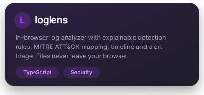
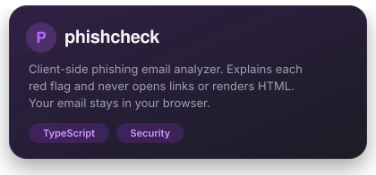
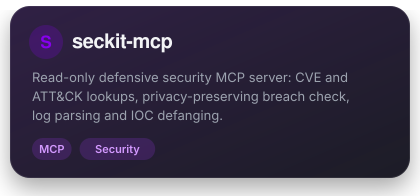
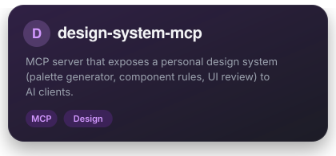

  

  
  
  
  

## About

Computer science graduate moving from building software to defending it. I join ExxonMobil as a Cybersecurity Technologist in December 2026, and in my own time I work on detection engineering and small tools that make security work easier to understand. Before that I built full-stack apps with React and .NET, and I still take freelance web, design and photography work.

| | |
|---|---|
| **Building** | A home SOC lab with Sigma and SPL detections, Python log analysis and Atomic Red Team tests |
| **Making** | Browser-based security tools that never send your data anywhere |
| **Learning** | Splunk, EDR tooling, Sysmon, Wireshark and incident response |
| **Open to** | Cybersecurity, AI engineering and full-stack freelance work |

## Featured projects

<table>
  <tr>
    <td width="50%" align="center"></td>
    <td width="50%" align="center"></td>
  </tr>
  <tr>
    <td width="50%" align="center"></td>
    <td width="50%" align="center"></td>
  </tr>
</table>

More projects

| Project | What it is |
|---|---|
| [portfolio](https://github.com/amrlhakimii/portfolio) | Portfolio and digital garden: React 19, TypeScript, Vite, Tailwind v4, on Netlify |
| [hootang](https://github.com/amrlhakimii/hootang) | Web app with PWA, Google sign-in and push notifications |
| [papvision](https://github.com/amrlhakimii/papvision) | Freelance client project |
| [voltaList](https://github.com/amrlhakimii/voltaList) | List app side project |
| [UbatLog](https://github.com/amrlhakimii/UbatLog) | Log app side project |

## Tech stack

   
   
  

**Security:** detection rules (Sigma, SPL), MITRE ATT&CK, log analysis, DNS/HTTP/tcpdump basics, Splunk, Sysmon, Wireshark

## GitHub stats

  
  
  

  

## Get in touch

Open to cybersecurity roles, AI engineering and freelance work.

  
  

